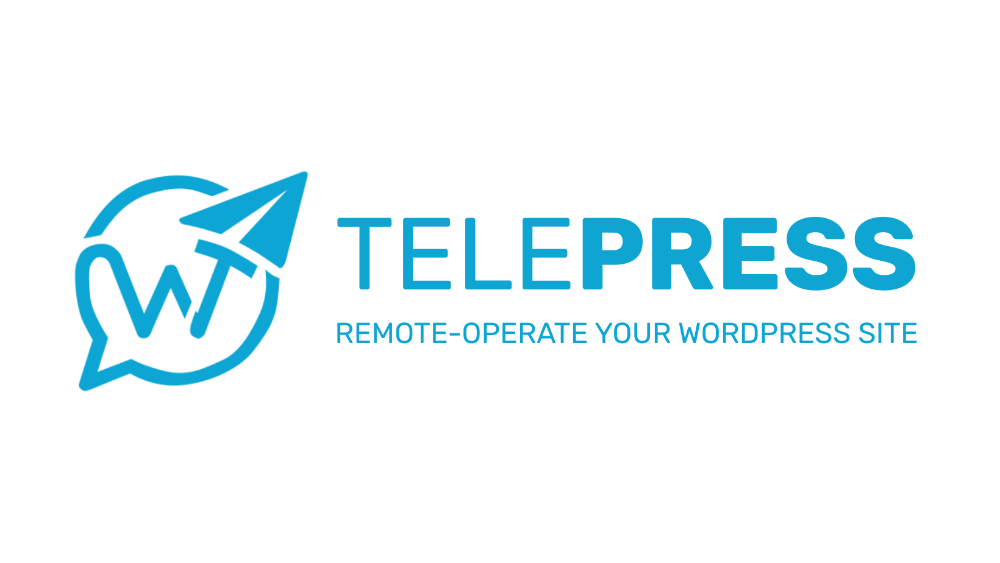

# WP Telepilot

WP Telepilot is a Telegram-first WordPress operations plugin for site owners and administrators who want a secure way to review site activity and perform structured actions from chat.

It links an approved Telegram account to a WordPress user, shows capability-aware menus, and gives admins a practical command surface for day-to-day operations without trying to turn Telegram into a full replacement for `wp-admin`.

## Links

- Product page: [alefdigitalsolutions.com/solutions/wp-telepilot](https://alefdigitalsolutions.com/solutions/wp-telepilot)
- Releases: [GitHub Releases](https://github.com/alefsolutions/wp-telepilot/releases)
- Command reference: [COMMANDS.md](COMMANDS.md)
- Report bugs: [alefdigitalsolutions.com/solutions/wp-telepilot](https://alefdigitalsolutions.com/solutions/wp-telepilot)

## Highlights

- Secure Telegram-to-WordPress account linking with short-lived one-time codes
- Webhook mode with polling fallback for environments where direct Telegram delivery is unreliable
- Role-aware menus and actions based on the linked WordPress user's actual capabilities
- Command groups for posts, pages, comments, media, users, plugins, categories, tags, notifications, and site settings
- Search, pagination, confirmations, and audit logging across the main management flows
- Guided post creation with in-chat follow-up actions
- Guided page creation with title-first flow and optional slug or status updates later
- Inline post category selection so users do not have to memorize category IDs
- Category-driven post creation, including creating a new draft directly from a chosen category
- Secure browser handoff for long-form post editing when chat is not the right editing surface
- Transport diagnostics for webhook health, polling health, queue activity, stale updates, and delivery failures
- Privacy integrations for WordPress personal-data export and erasure workflows
- Optional OpenAI chat with permission-filtered tools and explicit, single-use write confirmations
- Independently optional, authenticated read-only MCP through the official WordPress MCP Adapter

## What You Can Do

- Link a Telegram user to a WordPress user and restrict access with an allowed chat list
- Open `/menu` for a capability-aware Telegram command hub
- Review site status with `/site`
- Create, review, update, publish, draft, trash, restore, and browser-edit posts
- Create, review, update, publish, draft, trash, restore, and preview pages
- Review and manage comments, users, plugins, categories, and tags
- Manage Telegram notification preferences from chat
- Update selected site settings from Telegram with controlled validation
- Inspect transport health and operational diagnostics from the WordPress admin panel

## Installation

1. Install and activate WP Telepilot in WordPress.
2. Create a Telegram bot with BotFather.
3. Open `WordPress Admin -> WP Telepilot`.
4. Paste the Telegram bot token into the settings page.
5. Choose `Webhook` or `Polling Fallback`.
6. Save the settings so WP Telepilot can sync transport details.
7. Generate a one-time link code from the user's WordPress profile.
8. In a private chat with the bot, send `/link CODE`.
9. Use `/menu`, `/site`, or `/help` to begin.

## Core Telegram Flows

- `/start` shows onboarding and current chat details
- `/menu` opens the command hub
- `/help` shows the available command surface
- `/chatid` shows the current Telegram chat ID
- `/posts new` starts a guided draft-creation flow
- `/pages new` starts a guided draft page flow
- `/posts categories POST_ID` opens the inline category picker for an existing post
- `/categories post TERM_ID` starts a new post with that category preselected
- `/notifications list` reviews Telegram alert preferences

For the full command surface, syntax, and examples, see [COMMANDS.md](COMMANDS.md).

## Optional AI Assistant

Ordinary slash commands and callback buttons remain deterministic. OpenAI is used only for ordinary text during an authorized `/chat` session, not to parse every Telegram message. AI is disabled by default and initially restricted to administrators.

1. Open **WP Telepilot -> AI Assistant** in WordPress.
2. Enter an OpenAI API key and a model available to your OpenAI project. The default model is `gpt-4.1-mini`.
3. Enable AI chat, choose allowed tasks and role grants, then save. A role grant never replaces WordPress capabilities or target-object permissions.
4. Test the **saved** provider configuration. This makes a small, billable provider request; it does not test Telegram transport.
5. In your linked private Telegram chat, use `/chat`, then ask a question such as `List my draft posts`.
6. Use `/context` to inspect references, `/newchat` to clear context, `/cancel` to cancel the current request/proposals, and `/endchat` to leave AI mode.

Finish or cancel an unfinished guided post/page flow before entering AI mode. Normal commands such as `/posts`, `/pages`, and `/menu` remain available during AI chat.

AI chat is instructed to discuss only management of this WordPress site, including brief, relevant WordPress guidance. Unrelated questions and lists are refused; mixed requests receive help only with the site-management portion. Explanations stay within 2-3 sentences and about 60 words, even when more detail is requested. Longer lists are reserved for requested site results, with compact titles and IDs. Exact confirmation previews and required warnings retain their details.

Every provider request, including a queued continuation, receives fresh instructions and a capability catalog derived from the same permission assessment as the offered tools. The catalog distinguishes available tasks, administrator-disabled tasks, and tasks denied to the current WordPress account; an exhausted request budget is separate. Unsupported or denied actions do not need conversational approval. Supported writes go directly to a real proposal and the plugin's confirmation buttons. Terminal access/tool denials stop locally and are recorded in conversation history without another continuation or proposal.

### Reads And Confirmed Writes

AI can look up site information, posts, pages, comments, users, plugins, and category/tag terms when the corresponding tasks and capabilities are allowed. User emails are omitted by default.

The approved write set is deliberately limited: create post drafts, edit draft titles/excerpts, schedule posts, publish/unpublish posts, approve/trash comments, and activate/deactivate/update plugins. Media stays read-only. User management and page writes are not AI tools in this beta; existing authorized slash commands remain available.

Purpose, topic scope, and reply style live in `includes/ai/class-ai-prompt-builder.php`. Capability assessment lives in `includes/ai/class-ai-tool-registry.php`, and deterministic denial replies use `includes/ai/class-ai-error-policy.php`. Topic and prose-length compliance rely on model instructions and staging evaluation; there is no additional classifier, shortening request, or automatic hard word limit.

Before a write, review the site, target `[ID]`, title, exact changes, and scheduling timezone. Publishing, unpublishing, and plugin changes require a second explicit warning/confirmation. A model request alone cannot execute a write. Changed targets, revoked access, expired sessions, and replayed confirmations are rejected. Use the existing posts-only browser handoff for long content.

### Limits And Key Management

Defaults are a 60-minute inactivity timeout, five tool calls per request, two transient-error retries, three pending proposals, five-minute proposal expiry, 30 seconds per provider request, 1,200 output tokens, and 100 provider requests per site/day. Administrators can lower tool/retry/proposal limits and set the daily limit. Retries consume requests too. Provider requests and continuations run as separate queued jobs so ordinary commands can run between them.

Keys use authenticated AES-256-GCM encryption with WordPress salts, with no plaintext fallback. Leave the key field blank to retain it, supply a replacement to rotate it, or select removal. Changing WordPress salts or upgrading an unsupported legacy key format requires re-entering the key. Configuration changes invalidate active AI sessions. WordPress data changes clear stale conversation context and stop stale continuations; repeat the lookup for fresh results.

## Optional Read-Only MCP

MCP is separate from AI chat. It does not require an OpenAI key, Telegram bot, or Telegram linkage, and is disabled by default.

1. Use WordPress with the Abilities API (WordPress 6.9 or later) and install/activate the [official WordPress MCP Adapter](https://github.com/WordPress/mcp-adapter). The integration is tested with Adapter `0.6.1`.
2. In WP Telepilot's AI Assistant tab, independently enable MCP, grant roles, and select the specific read abilities to expose. No reads are approved by default.
3. Save, then configure your MCP client with `https://YOUR-SITE/wp-json/wp-telepilot-mcp/v1/server` and an application password for an authorized WordPress user. Use a dedicated least-privilege account and HTTPS.
4. Test initialization, tool discovery, and one approved read from your client. The admin's configured status is not proof of a live client connection.

Only explicitly approved read tools are registered on the dedicated `wp-telepilot-readonly` server. Permissions are rechecked per call; Telepilot write tools are not registered with the WordPress Abilities API, generic REST discovery, or the Adapter's default server. Missing MCP dependencies do not disable ordinary commands or AI chat. Review your MCP client's data handling before connecting it.

## Transport Modes

### Webhook

Webhook mode is the preferred option for near-real-time Telegram replies. In this mode, Telegram sends updates directly to the WP Telepilot REST endpoint, and WP Telepilot validates the configured webhook secret before processing the request.

### Polling Fallback

Polling fallback is available for sites where webhooks are blocked, delayed, challenged by infrastructure, or otherwise unreliable. In this mode, WP Telepilot checks Telegram for updates through scheduled jobs instead of waiting for inbound webhook delivery.

## Security And Reliability

- Link codes are short-lived and stored server-side
- Sensitive actions are restricted to private chats
- Webhook requests validate the Telegram secret header
- Duplicate Telegram updates are ignored
- Stale Telegram updates are dropped
- Accepted updates are persisted before processing; commands, notifications, and delivery use the background queue
- Per-chat leases serialize operations while unrelated chats can proceed
- Polling uses a lock to prevent overlapping workers
- Destructive actions require confirmation
- Audit records are written for linking, moderation, content actions, and delivery events

## Admin Panel

From the WP Telepilot settings page, administrators can:

- configure the bot token
- choose webhook or polling transport
- manage the webhook secret
- restrict allowed chat IDs
- enable or disable user linking to Telegram
- review webhook and worker diagnostics
- inspect queue, cron, schema, and database readiness
- refresh webhook status
- poll Telegram manually when polling mode is enabled
- process queued jobs
- flush pending Telegram updates
- select one or many types of notifications or alerts they want to receive via Telegram.

## Privacy And External Services

WP Telepilot connects to the Telegram Bot API only after an administrator configures a bot token.

When enabled, the plugin may send:

- the configured bot token as part of authenticated Bot API requests
- Telegram user and chat identifiers required to route responses
- webhook registration details in webhook mode
- response payloads generated from WordPress data that an authorized linked user explicitly requested

WordPress privacy-policy helper text, exporter callbacks, and eraser callbacks are included for linked Telegram data.

Telegram is a third-party service:

- Terms of service: [telegram.org/tos](https://telegram.org/tos)
- Privacy policy: [telegram.org/privacy](https://telegram.org/privacy)

When administrators enable and configure OpenAI, AI requests send the user's text, bounded conversation context, approved tool schemas, and minimized authorized tool results to OpenAI. The saved-configuration test also contacts OpenAI. Provider calls incur usage charges. Credentials, IP addresses, and security links are filtered out; supported email fields require a separate explicit administrator opt-in, and incidental email text remains masked. The plugin requests `store: false`; this does not replace the provider's own retention policies. See [OpenAI terms](https://openai.com/policies/terms-of-use/) and [privacy policy](https://openai.com/policies/privacy-policy/).

MCP returns authorized WordPress data to the authenticated client you configure, not automatically to OpenAI. AI history is bounded and expires with the session; pending proposals expire after five minutes. Queued payloads and AI context participate in WordPress privacy export/erasure. Redacted audits follow the saved retention setting. Removing local data cannot erase copies already delivered to external services.

## Requirements

- WordPress 6.6 or newer
- PHP 8.0 or newer
- PHP mbstring; OpenSSL with AES-256-GCM for AI key storage
- HTTPS for webhook mode
- HTTPS and the optional dependencies above for MCP
- Current development version: `0.4.0-beta.4`; maintenance candidate: `0.3.1`

## Project Status

The `v4` branch targets `0.4.0-beta.4` and incorporates the `0.3.1` maintenance repairs. It is a beta candidate, not a stable-readiness declaration. Isolated tests cover standard/custom roles, native commands, mocked OpenAI/Telegram, confirmed writes, native plugin upgrades, real concurrent workers/editor saves, privacy, migrations, and the official MCP Adapter HTTP transport. The compatibility matrix is WordPress 6.6.2/PHP 8.0 and WordPress 7.1/PHP 8.5. Local desktop/mobile admin fixture checks complement, but do not replace, testing in a real wp-admin installation. Live staging Telegram/OpenAI/MCP checks remain required before publication.

### Beta.4 Telegram Feedback

Commands, guided input and uploaded files use best-effort typing feedback before their useful response. Buttons acknowledge silently and retain the existing message and keyboard until the final result. Routine AI continuations no longer send processing text; provider retry notices, confirmations and errors remain visible.

Typing refreshes at work boundaries and during compatible cURL transfers, with a one-second feedback timeout and failure isolation. Existing queued reply targets and delivery-only retries are preserved. This update adds no setting or database migration; blocking local work and unsupported HTTP transports can leave brief typing gaps.

### Beta.3 Bug Fixes

Beta.3 repairs the eleven issues found in the codebase review. Suspension now ends browser sessions and blocks passwords and application passwords before `init`; application passwords become usable again after re-enabling, but old browser sessions do not. Disabling new Telegram linking blocks code generation and consumption while preserving existing links and unused codes until their original expiry.

User messages and buttons execute in acceptance order within each chat, ahead of AI continuations and delivery retries. Blocked chats cannot hide unrelated jobs behind the first queue batch. Validation errors return normal error responses; genuine uncertain executions still require Queue Recovery review and are never automatically replayed.

Search pagination uses actor-bound controls valid for 15 minutes. Repeat the search when a control expires. Taxonomy changes enforce assignment permissions, backslashes survive text writes, default-category deletion is refused before reassignment, and privacy erasure anonymizes all matching audit records or reports a retryable failure.

### Beta.2 Queue Repair

This update explicitly repairs a historical queue constraint that could stop AI replies after their first lookup. It preserves existing queue IDs and Telegram deduplication, verifies the actual column and unique index, and tracks repair completion separately from the plugin schema version. No command syntax, linked accounts, credentials, or WordPress content is changed by this repair.

Diagnostics and Site Health distinguish existing tables from a verified AI continuation schema. If repair fails, AI provider requests pause while ordinary commands remain available where possible. An administrator can use **Retry Database Repair** in diagnostics after resolving database permissions or locks. Automatic attempts are limited to once every five minutes. Unexpected schema differences require host/database-administrator review rather than a blind conversion.

A failed continuation save stops that request and displays a safe reference ID. Failed AI requests are not automatically resubmitted after repair; send a new request only after diagnostics verify the queue. Back up before upgrading and verify final Telegram replies on staging before publishing this beta.

Additional regressions cover real concurrent PHP workers and browser saves, command-menu reads across standard/custom roles, nested queue transactions, schedule dates, notification target access and polling persistence failures. The maintenance candidate does not include OpenAI or MCP; those remain on the separate V4 beta branch.

### Maintenance Upgrade

Existing WordPress content, linked accounts and ordinary settings are preserved. Old pending operations are quarantined rather than replayed. Generate fresh browser-editor links and confirmations after upgrading. Notifications go only to authorized, active linked private chats; an allowed chat ID does not subscribe a recipient.

Queue Recovery in settings lets administrators inspect and cancel uncertain jobs without repeating their actions. A failed Telegram delivery retries the saved response, not the WordPress mutation. WordPress cron must run reliably for delivery and retention. Completed payloads expire within 24 hours and failed-delivery payloads within seven days under hourly maintenance. Logs omit credentials, security URLs and sensitive message bodies.

The posts-only browser editor uses unique, one-time links with an absolute one-hour maximum expiry. Unlinking, suspension and deactivation revoke access. Concurrent content changes require a fresh link instead of overwriting the newer content.

For early V4 builds, the upgrade clears unsafe legacy AI actions and sessions and removes the unsupported AI Manage Users setting. Unsupported legacy encrypted/plain key formats disable AI until the key is replaced. Recheck task grants, model access, and MCP settings after upgrading. Back up the database before installing a beta; downgrading a database is not an automatic migration path.

## Development And Packaging

Telegram command execution uses best-effort typing feedback instead of generic processing messages. Buttons are acknowledged silently after queue persistence and keep their existing message and keyboard until the final result is delivered. Routine AI tool continuations are silent; provider retry delays, confirmations, and errors still produce useful notices. Existing queued placeholder messages remain valid reply targets after upgrading.

Typing starts when an accepted request executes and refreshes at most once every four seconds at work boundaries and during compatible WordPress cURL transfers. Feedback requests have a one-second timeout, and the first feedback failure disables further attempts for that execution without affecting the operation. Scoped HTTP hooks are removed before final delivery. Notifications, delivery-only retries, and scheduled retry waits do not show typing. Blocking database, filesystem, image-processing work, and HTTP transports without cURL progress support can leave brief gaps; there is no extra heartbeat worker or configuration toggle.

The reproducible PHPUnit environment uses a disposable `telepilot_tests` database and blocks external HTTP unless explicitly mocked. Install development dependencies with Composer, install matching WordPress core with `php scripts/install-test-wordpress.php 6.6.2`, and run `composer test`. Database connection overrides use the `TELEPILOT_TEST_DB_*` environment variables; never use production credentials. Enable PHP's ZIP extension for upgrader and packaging tests.

CI tests the declared minimum and current release combination, then tests an extracted installable package. `php scripts/package.php` builds an allowlisted ZIP excluding Markdown, documentation, tests, and development dependencies. The release workflow never force-updates tags or replaces an existing release; an unchanged version is skipped. Betas require an explicitly requested prerelease workflow run. A local commit or ZIP build does not publish a release.

## Product Direction

WP Telepilot is designed around a simple principle:

> Telegram is for awareness, decisions, and short actions. WordPress remains the place for long-form editing, visual design, and complex configuration.

## License

WP Telepilot is licensed under the GNU General Public License, version 2 or later, the same license used by WordPress.
